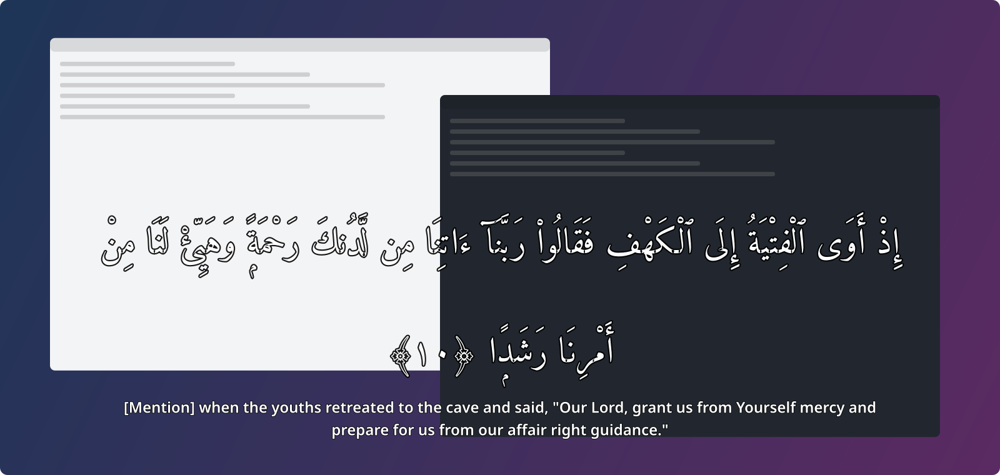
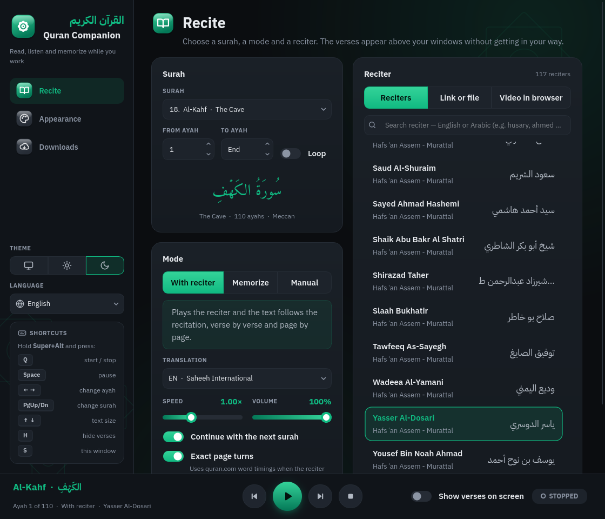
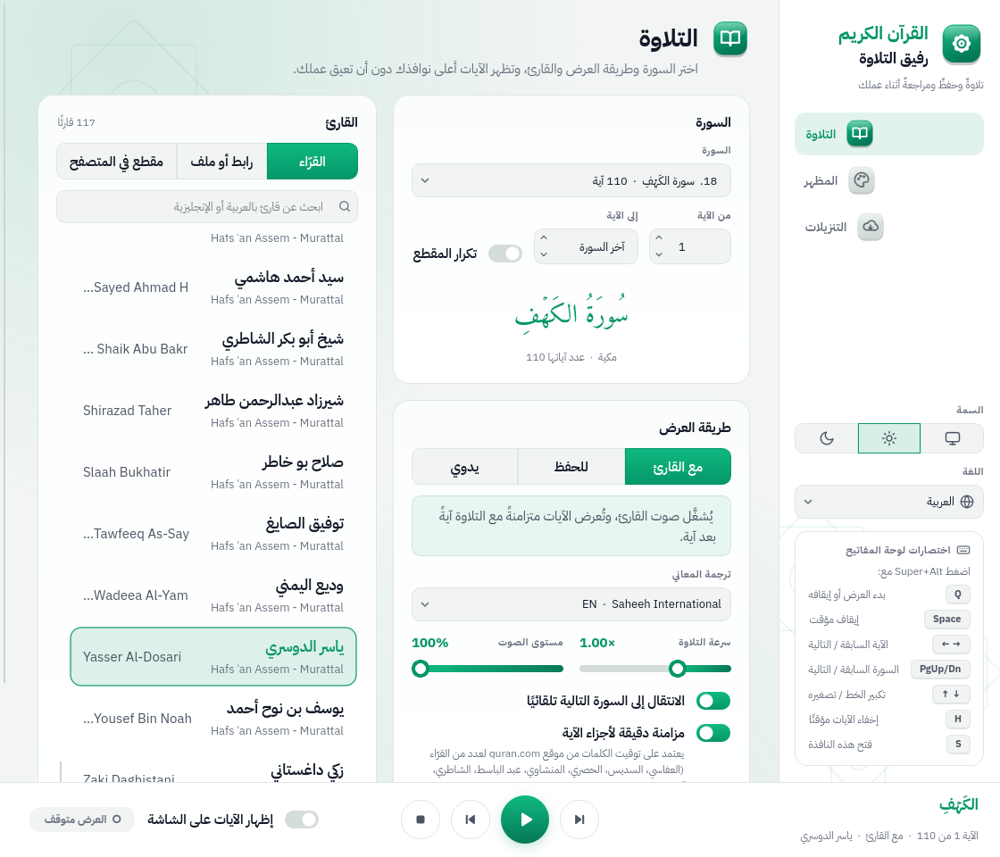
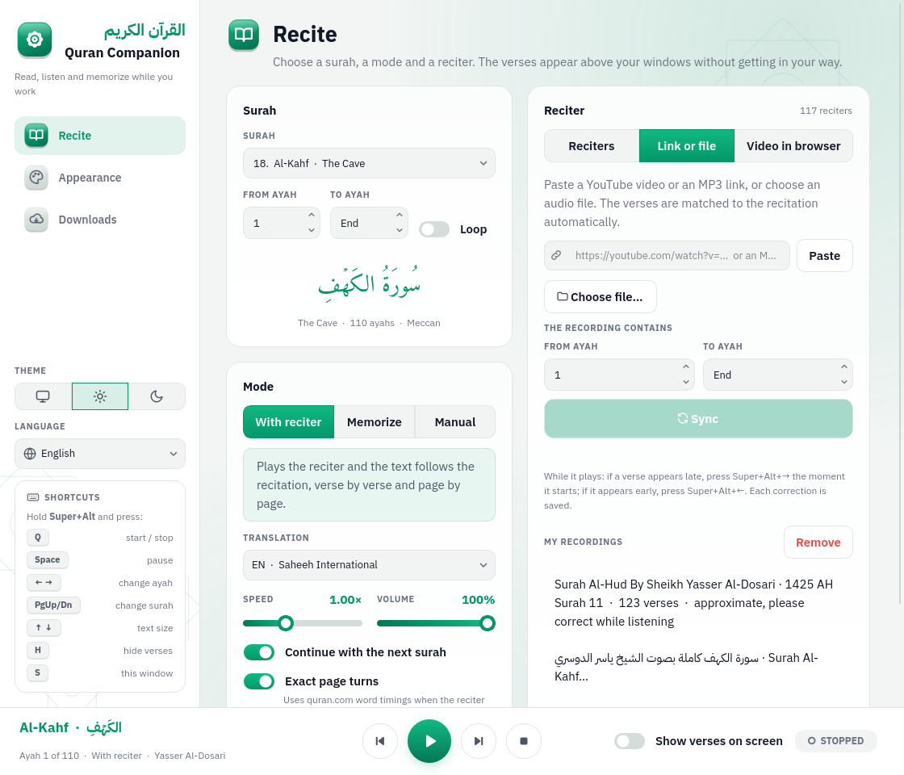
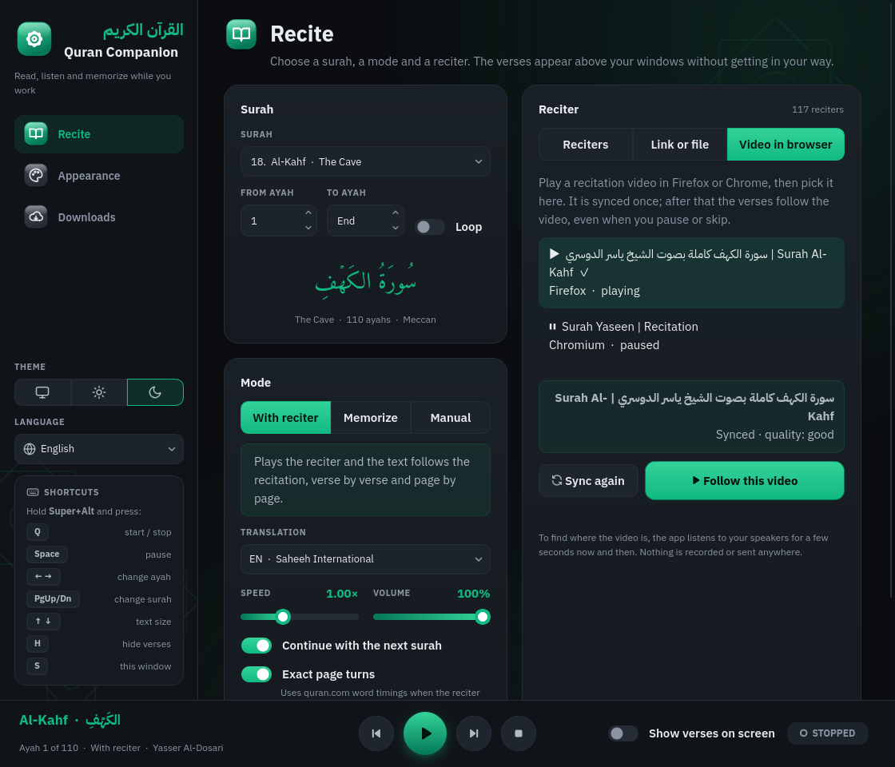
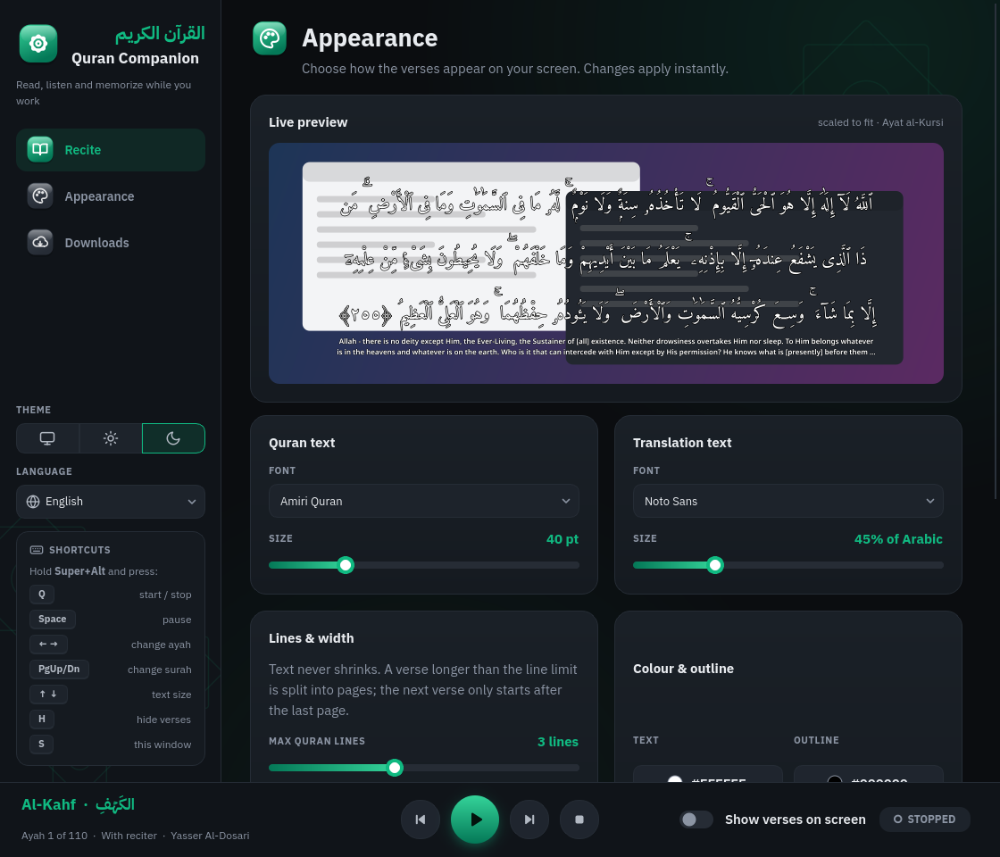
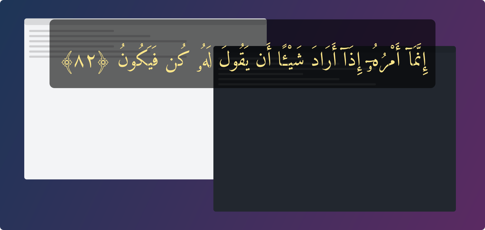
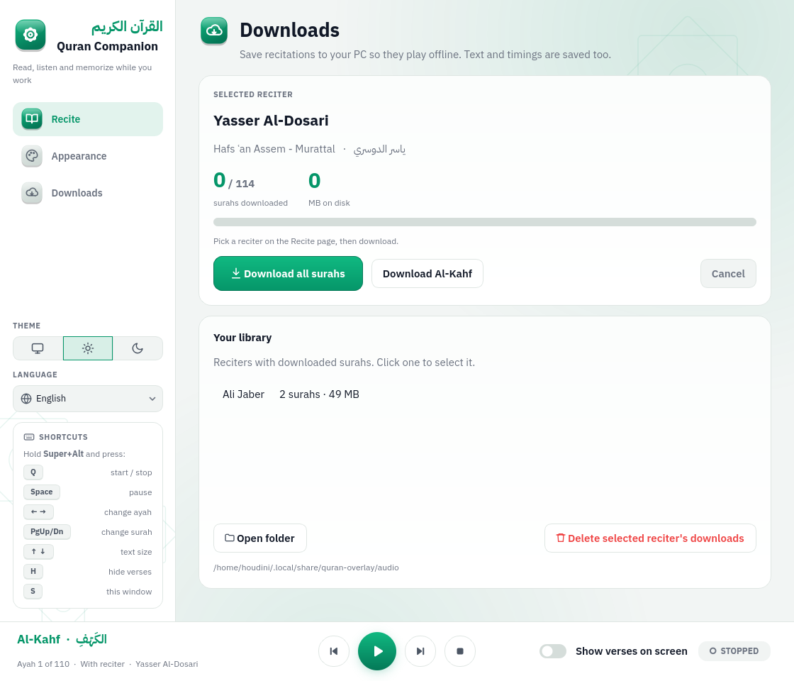

# Quran Companion · رفيق التلاوة

**Quran verses on your screen while you work.** A reciter plays and the verse he is reciting appears over your
windows, like subtitles, with its translation. The text never takes focus and clicks pass straight through it, so
you keep typing, browsing or coding underneath.



It can also help you **memorize** (verses appear one after another, silent, at your pace, with hints), follow a
recitation **you found on YouTube or have as an MP3**, or follow a **video playing in your browser**, so the right
verse is on screen even when you pause or skip.

The settings window is in **Arabic and English**, with a light and a dark theme.

## Contents

- [What it does](#what-it-does)
- [Install](#install)
- [Using it](#using-it)
- [Keyboard shortcuts](#keyboard-shortcuts)
- [Your own recitations: links, files and browser videos](#your-own-recitations-links-files-and-browser-videos)
- [Appearance](#appearance)
- [Offline use](#offline-use)
- [Privacy](#privacy)
- [Where things are stored](#where-things-are-stored)
- [Command line](#command-line)
- [Architecture](#architecture)
- [Development](#development)

## What it does

| | |
|---|---|
| **With reciter** | Plays a reciter and shows each verse as it is recited, page by page for long verses. 115 reciters with verse timings, from mp3quran.net. With **Exact page turns** on, reciters that quran.com has word timings for (Alafasy, Sudais, Husary, Minshawi, Abdul Basit, Shatri, Shuraim…) turn the page of a long verse exactly on the word. |
| **Memorize** | Silent. Verses appear on their own, at a pace you choose: by verse length, a fixed time per verse, or the selected reciter's real pace (muted). Optional hints: show the first words and then the verse, or show the verse and then hide it so you recite from memory. You can repeat each verse and add a pause after it. |
| **Manual** | Silent. The text only moves when you press a key, handy while a recitation plays somewhere else. |
| **Links and files** | Paste a YouTube or MP3 link, or choose an audio file. The app works out when each verse starts, and the verses then follow that recording. |
| **Video in browser** | Play a recitation video in Firefox or Chrome. After one sync, the verses follow the video in the browser, including pauses, skips and ads. |
| **Translations** | Any translation from alquran.cloud, shown under the Arabic in a smaller size. |

<p>
  
  
</p>

## Install

**Download** from the [latest release](https://github.com/YakoubBenaisa/quran-subs/releases/latest) or the
[website](https://yakoubbenaisa.github.io/quran-subs/):

| System | File |
|---|---|
| Windows 10/11 | `QuranCompanion-windows-x64-setup.exe` (installer) or `-portable.zip` |
| macOS 11+ | `QuranCompanion-macos-arm64.dmg` (Apple Silicon) or `-macos-x86_64.dmg` (Intel) |
| Linux | `QuranCompanion-linux-x86_64.AppImage` or `.tar.gz`; Flathub is planned |

Everything is included: Qt, the audio player, ffmpeg and yt-dlp. On Windows the shortcuts use **Win+Alt**, on
macOS **Ctrl+Option** (macOS asks once for the Accessibility permission), on Linux **Super+Alt** (run
`QuranCompanion setup-shortcuts` once on GNOME). Following a video in the browser is Linux only.

**From source** (any system, Python 3.11+):

```sh
python3 -m pip install --user ".[media]"      # PySide6, numpy, yt-dlp, an ffmpeg binary, …
python3 -m quran_companion ui
```

On Linux you can also use the launcher, which works from inside a Flatpak sandbox such as Flatpak VS Code:

```sh
./quran-overlay.sh install-desktop   # adds "Quran Companion" to the app menu
./setup-shortcuts.sh                 # adds the Super+Alt shortcuts (keeps your other custom shortcuts)
./quran-overlay.sh ui                # opens the settings window
```

Audio plays through `ffplay` when it is installed, otherwise through Qt Multimedia (`QOV_PLAYER=qt|ffplay`
chooses). Release files are built with `python packaging/build.py`.

## Using it

1. Open the settings window (app menu, or **Super+Alt+S**).
2. On **Recite**, choose a surah, and optionally a range of verses and whether to loop it.
3. Choose a mode: **With reciter**, **Memorize** or **Manual**.
4. Choose a reciter (search works in English or Arabic, e.g. "husary" or "الحصري") and a translation if you want one.
5. Press **Play** in the bar at the bottom, or double-click the reciter. Press **Super+Alt+Q** any time to start or
   stop.

The bar at the bottom always shows where you are, and the **Show verses on screen** switch hides the text without
stopping the recitation. With **Continue with the next surah** on, the reciter carries on into the next surah.

## Keyboard shortcuts

They work everywhere, even when the settings window is closed. Hold **Super+Alt** and press:

| Key | Action |
|---|---|
| Q | start / stop |
| Space | pause / resume |
| → / ← | next / previous verse (or page of a long verse) |
| Page Down / Page Up | next / previous surah |
| ↑ / ↓ | bigger / smaller text |
| H | hide / show the verses |
| S | open the settings window |

While one of your own recordings plays, → and ← also **correct its timing**: see below.

## Your own recitations: links, files and browser videos

Many beautiful recitations are only on YouTube, or only as an MP3 somewhere, and have no verse timings. Quran
Companion can work them out.

### Link or file



1. On **Recite → Reciter**, open **Link or file**.
2. Paste a YouTube or MP3 link, or choose an audio file. The surah and reciter are recognised from the title
   when it names them ("Surah Al-Kahf | Mishary Alafasy", "سورة الكهف - ياسر الدوسري"). Otherwise choose the
   surah yourself.
3. If the recording holds only part of the surah, set the verses it contains.
4. Press **Sync**. A long surah takes about a minute.

The recording then appears in **My recordings** and in the reciter list, and plays like any other reciter.

<br clear="right">

**How the sync works.** The app compares your recording with the same surah recited by three reciters whose verse
timings are known (DTW, dynamic time warping, over MFCC sound features), carries their verse starts across, and
places each verse on the nearest pause in the recitation. When the reciters disagree about a stretch, the one whose
verses fit your recording best is used. If your recording *is* one of the published recordings (common for YouTube
uploads), that recording alone is used and the timings come out nearly exact. Talk before or after the
recitation is skipped, and a video that plays the surah twice gets both passes synced.

Each recording gets a quality label: **good**, **fair**, or **approximate, please correct while listening**.
Measured on recordings with known timings, most verse starts land within half a second for a regular (murattal)
recitation. Slow, ornamented (mujawwad) recitations and prayer recordings with long pauses are harder.

**Fixing a verse while you listen.** If a verse appears late, press **Super+Alt+→** the moment it actually starts;
if it appears early, press **Super+Alt+←**. The rest of the recording is re-matched from that point and the
correction is saved, so each fix also improves the verses after it.

### Video in browser



1. Play a recitation video in Firefox or Chrome.
2. On **Recite → Reciter**, open **Video in browser**. It lists what your browsers are playing.
3. Pick the video and press **Sync this video** (once per video). If the title doesn't say which surah it is,
   choose the surah and press **Sync as …**.
4. Press **Follow this video**.

The verses now follow the video, not the app's own audio. Pause, resume or jump in the video and the text follows;
pausing from the app (Super+Alt+Space) pauses the video. When an ad or another video plays, the text waits.

Chrome reports its playback position continuously. Firefox only reports it when you play, pause or jump, so the
app also listens to your speakers for a few seconds now and then to find its place in the recitation (see
[Privacy](#privacy)).

<br clear="right">

## Appearance



Everything about the on-screen text can be changed, with a live preview:

- Quran font (Amiri Quran is included) and size; translation font and size relative to the Arabic
- text color, outline color and thickness
- an optional background box, its color and transparency
- position at the top or bottom of the screen, and the distance from the edge
- the most lines of Arabic and of translation, and the widest the text may be

Text never shrinks to fit. A verse longer than the line limit is split into pages, and the next verse only starts
after its last page.

The settings window itself follows your system theme or a fixed light or dark one, and its font can be changed
separately from the Quran text.

<br clear="right">

<p align="center">
  
</p>

## Offline use



On **Downloads**, save a surah or all 114 surahs of a reciter. The text, translation and timings are saved with
them, so recitation works without a connection. **Your library** lists the reciters you have downloaded; click one
to select it.

<br clear="right">

## Privacy

- To follow a **browser video**, the app reads what Firefox or Chrome reports to the desktop (title, link, playing
  or paused) and, every 15 seconds or so, listens to a few seconds of your **speakers' output** (not the
  microphone) to find the position in the recitation. That sound stays in memory, is compared and dropped. Nothing
  is recorded to disk or sent anywhere.
- Network use: Quran text and translations from api.alquran.cloud; reciters, audio and verse timings from
  mp3quran.net; word timings from quran.com; and the links you paste yourself (through yt-dlp).

## Where things are stored

| What | Where |
|---|---|
| Settings | `~/.config/quran-overlay.json` (Windows: `%APPDATA%\QuranCompanion`, macOS: `~/Library/Application Support/QuranCompanion`) |
| Downloaded text, timings, lists | `~/.cache/quran-overlay/` |
| Downloaded recitations | `~/.local/share/quran-overlay/audio/` |
| Your own recordings (audio, timings, corrections) | `~/.local/share/quran-overlay/mine/` |

`QOV_CFG`, `QOV_CACHE`, `QOV_LIB` and `QOV_MINE` override these paths.

## Command line

```sh
./quran-overlay.sh ui              # settings window
./quran-overlay.sh toggle          # start / stop the on-screen verses
./quran-overlay.sh next            # also: prev pause hide bigger smaller nextsurah prevsurah quit
./quran-overlay.sh surah 36 [ayah] # jump to a surah (and verse)
./quran-overlay.sh overlay --surah 18 --mode memorize
./quran-overlay.sh install-desktop # app-menu entry
./setup-shortcuts.sh               # GNOME shortcuts (Super+Alt+…)
```

The settings window and the on-screen verses are separate processes; commands reach the running verses over a local
socket (`$XDG_RUNTIME_DIR/quran-overlay.sock`).

## Architecture

Imports only point downwards; `tests/test_architecture.py` enforces that the logic layers never import Qt.

| Layer | Package | Responsibility |
|---|---|---|
| Views | `settings_ui/views`, `settings_ui/widgets`, `settings_ui/theme` | Qt widgets only: build, display, forward user actions |
| View models | `settings_ui/viewmodels` | Window state and actions (catalog, playback control, downloads, own recordings, language/theme) |
| Overlay | `overlay/` | `OverlayWindow` draws pages; `OverlayController` wires session ⇄ window ⇄ commands |
| IPC | `ipc/` | Typed commands, JSON wire format + plain-text form, version handshake (`hello`) |
| Playback | `playback/` | `Session` state machine; modes as strategies (`recite`, `memorize`, `manual`); `AudioPlayer` (ffplay), `BrowserPlayer` (follows a browser video via MPRIS + `Locator`), `RoutingPlayer`, `Clock` |
| Sync | `sync/` | Verse timings for recordings without them: MFCC features, banded DTW with open ends, pause detection, the multi-reference engine, `SyncService` |
| Layout | `layout/` | `Paginator`: verse → pages of at most N lines (text measuring injected) |
| Data | `data/` | Source interfaces + adapters (alquran.cloud, mp3quran.net, quran.com), disk cache, downloads, media fetching (yt-dlp), own recordings, `QuranRepository` |
| Core | `core/` | Models, settings (atomic store + migration), Arabic text rules, title guessing, translations |

`app.py` is the composition root: it builds the object graph for each entry point.

Patterns: Repository + Adapter (data sources), Strategy (playback modes, memorize advance policies), State machine
(`Session`), Command (IPC), Observer (Qt signals / session listener), MVVM (settings window), dependency injection
(clock, player, measurer, sources are passed in, so tests use fakes).

## Adding an interface language

Copy `quran_companion/resources/lang/en.json` to e.g. `fr.json`, set `"_name"` and `"_dir"` (`"rtl"` for
right-to-left), translate the values. It appears in the language list automatically; missing keys fall back to English.

## Development

```sh
python3 -m pip install --user ".[dev]"
python3 -m pytest          # offline: uses tests/fixtures, fake clock/player, offscreen Qt
python3 -m ruff check quran_companion tests
python3 -m mypy            # logic layers
```

`tests/golden/golden.json` was recorded from the pre-refactor single-file app (`git show d36b646:overlay.py`) with
`tests/make_golden.py`; the paginator must keep reproducing it exactly.

The screenshots in `docs/screenshots/` are rendered from the real settings window and the app's own preview painter.

## Credits

Quran text and translations: [alquran.cloud](https://alquran.cloud). Recitations and verse timings:
[mp3quran.net](https://mp3quran.net). Word timings: [quran.com](https://quran.com). Fonts: Amiri Quran and IBM Plex
Sans Arabic (SIL Open Font License).
